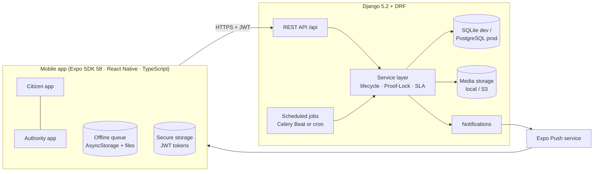
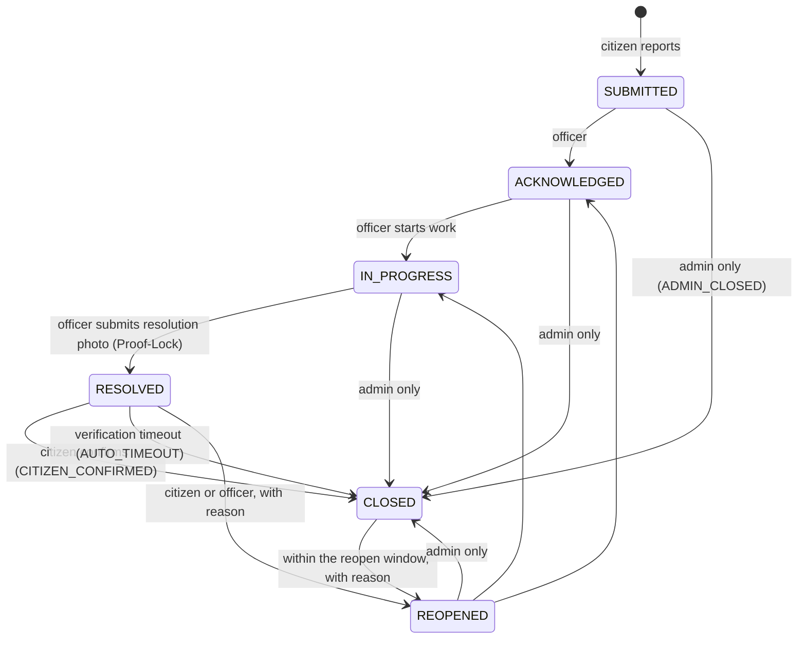
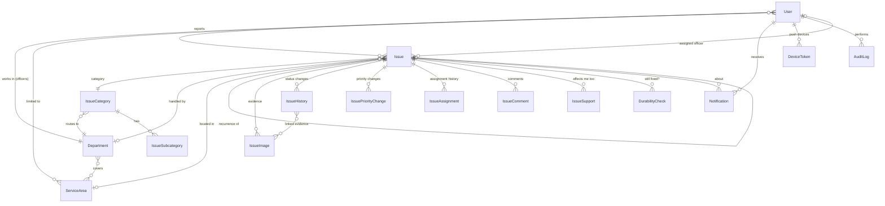

# CivicEye architecture

## System overview



- **The backend enforces every rule.** The app's role cards only choose which sign-in form to show. After login, the app routes by the `role` the server returns, and every endpoint checks role, ownership and department scope.
- **Views stay thin.** All status changes go through `apps/issues/services.py`, which validates the transition, stamps timestamps, writes `IssueHistory`, writes an `AuditLog` entry and sends notifications.

## Roles

| Role | How the account is created | Sees |
|---|---|---|
| `CITIZEN` | Self-registration in the app | Own complaints in full; other complaints in a public-safe view (approximate location, no reporter data) |
| `OFFICER` | Django admin | Issues in their department (limited to their service areas, if any are set) plus issues assigned to them |
| `SUPERVISOR` | Django admin | Every issue in their department; can transfer issues to other departments and override Proof-Lock flags |
| `ADMIN` | `createsuperuser` / Django admin | Everything; can close issues directly (`ADMIN_CLOSED`) |

## Issue lifecycle



The backend rejects any other transition with `400 invalid_transition`.

Each transition stores the previous status, new status, actor (empty for system jobs), timestamp, reason, closure type and linked evidence images. History rows are never updated or deleted.

**Priority is separate from status.**
- On submission, priority comes from rules: the category default, raised one level when the citizen marks it urgent (never above High), and CRITICAL for life-threatening categories.
- When enough people say "affects me too", the *recommended* priority rises, but the official priority does not change.
- Officers change the official priority with a mandatory reason, which is stored in `IssuePriorityChange`.

**SLA.**
- Acknowledgement and resolution deadlines come from the category's SLA.
- The resolution deadline is shortened to the per-priority maximum (`PlatformConfiguration.priority_sla_hours`) when that is stricter.
- Life-threatening categories get a 1-hour acknowledgement SLA.
- A scheduled job marks issues overdue and alerts staff once per breach.

## Signature features implemented

| Feature | Where |
|---|---|
| **Proof-Lock resolution.** Resolution photos must come from the in-app camera. Their GPS position must be within 50 m of the reported location, with accuracy of 30 m or better. A perceptual hash rejects reused photos. A supervisor can override a flagged photo with a reason. | `issues/services.py: resolve, _evaluate_proof, override_proof_check` · `GhostOverlayCamera.tsx`, `ResolveIssueScreen.tsx` |
| **Fix durability check.** A configurable number of days after closure (default 30), the app asks "Is it still fixed?". "Problem returned" opens a *linked recurrence* issue rather than reopening the closed one. | `community/services.py` · `IssueDetailScreen.tsx` |
| **Affects me too.** Nearby duplicate suggestions before submitting; support for an existing issue; impact count; supporters receive updates. | `community/services.py`, `issues/views.py: NearbyIssuesView` |
| **Offline queue.** Reports captured offline are queued with an idempotency key and sent automatically when the device reconnects. | `mobile/src/offline/queue.ts` · `Issue.client_submission_id` unique constraint |
| **Life-Safety Fast Lane.** Emergency numbers are shown first, the issue is marked CRITICAL, officers get an immediate high-priority alert, and the acknowledgement SLA is 1 hour. | `IssueCategory.is_life_threatening`, `EmergencyContact` |
| **Feature flags.** Each feature can be switched on or off in Django admin; disabled features return `403 feature_disabled`. | `core/models.py: FeatureFlag` |

## Data model



Key constraints:
- `Issue.complaint_id` is unique, in the form `CE-<year>-<6 digits>`.
- (`reporter`, `client_submission_id`) is unique, which is how offline submissions stay idempotent.
- Latitude and longitude must be within valid ranges, and the satisfaction rating must be 1–5.
- (`issue`, `user`) is unique for supports, and (`issue`, `recipient`) is unique for durability checks.
- `Notification.dedupe_key` is unique, so notifications are idempotent.
- Officers and supervisors must belong to a department (database check constraint).

## Security

- **Authentication.** JWT via SimpleJWT, with 15-minute access tokens and 7-day refresh tokens. Refresh tokens rotate, and old ones are blacklisted. Logout and password changes revoke tokens.
- **Passwords.** Hashed with Django's PBKDF2 hasher and checked by the standard password validators. Password resets use a 6-digit emailed code: only its hash is stored, it expires after 15 minutes and allows 5 attempts.
- **Scoping.** Object access is scoped in querysets (`issues_visible_to_authority`, `reporter=request.user`), so out-of-scope objects return 404 and are never leaked.
- **Uploads.** Each upload is opened and verified with Pillow; only JPEG, PNG and WebP up to 8 MB are accepted, with a pixel limit against decompression bombs. Images are re-encoded to JPEG, which strips EXIF data (including the camera's GPS and device details). Files get random UUID names.
- **Private data.** Reporter contact details are only returned by authority endpoints. Public views round coordinates to about 100 m. CSV exports escape spreadsheet formulas.
- **Throttling.** Rate limits apply to anonymous users, logged-in users, login/registration, password reset, issue creation and support actions.
- **Audit log.** Every transition, priority change, assignment, Proof-Lock override, feature-flag change, role grant and CSV export is recorded in `AuditLog`, which is read-only in Django admin.
- **Mobile.** Tokens are kept in the Keychain/Keystore via `expo-secure-store`. Nothing sensitive is logged.

## Project structure

```
EyeLocation/
├── backend/
│   ├── config/                 settings (env-driven), urls, celery, wsgi/asgi
│   ├── apps/
│   │   ├── accounts/           custom User, roles, JWT auth, password reset, permissions
│   │   ├── departments/        Department, ServiceArea
│   │   ├── issues/             Issue + images/history/comments, lifecycle services, citizen & authority APIs
│   │   ├── assignments/        IssueAssignment history
│   │   ├── community/          IssueSupport ("affects me too"), DurabilityCheck
│   │   ├── notifications/      in-app notifications, device tokens, Expo push task
│   │   ├── analytics/          dashboard KPIs, charts, reports, CSV export
│   │   ├── audit/              AuditLog
│   │   └── core/               feature flags, platform config, errors, images, geo, scheduled jobs, seed
│   ├── requirements.txt  .env.example  manage.py   (served by Daphne: config.asgi)
└── mobile/
    ├── app.config.js  .env.example  jest.setup.ts
    └── src/
        ├── api/                client (JWT refresh, errors), auth/issue/authority/notification/reference APIs
        ├── components/         IssueCard, badges, ImageUploader, LocationPicker, GhostOverlayCamera, charts…
        ├── navigation/         Root, Auth, Citizen, Authority navigators + route types
        ├── screens/            auth/, citizen/, authority/, shared/
        ├── store/              zustand: auth, reference data, offline queue, notifications
        ├── offline/            persistent offline report queue
        ├── hooks/ utils/ theme/ constants/ types/
        └── __tests__/
```
